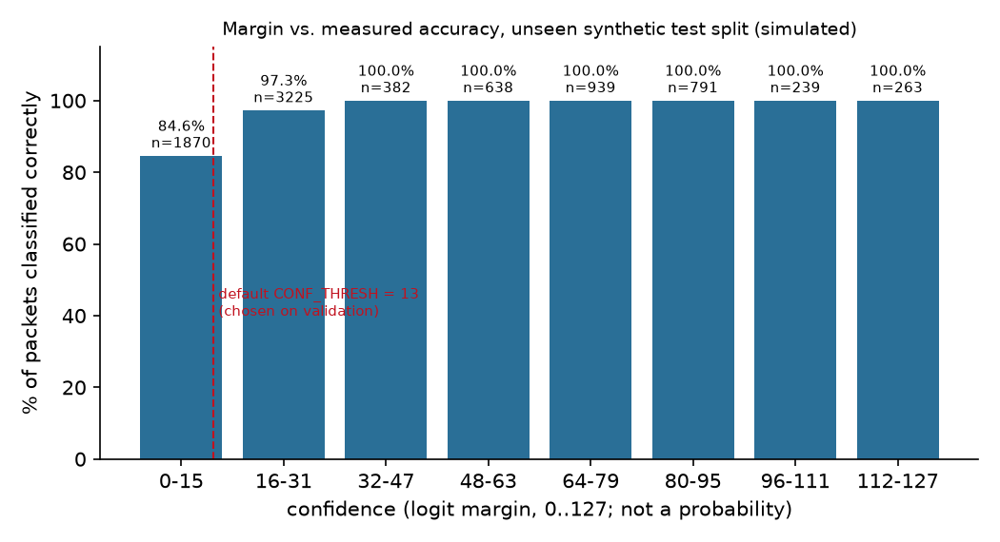

# M3 results: neural net accuracy

All numbers are **simulated** (Python models) on **synthetic** traffic from the project's own
generator. Synthetic data is easier than real traffic, so this is not real-world accuracy.
The test split uses scenario seeds that training never saw. Regenerate with
`python -m model.train && python -m model.quantize && python -m model.evaluate`.

The test split has 9000 frames; the parser drops 653 of them (malformed or
unsupported), so 8347 reach the neural net. Dropped frames are not in the tables below.

### int8 (the chip arithmetic, golden model), test split

Accuracy: **95.50%** on 8347 classified packets.

| class | precision | recall |
|---|---|---|
| normal | 98.53% | 94.45% |
| port_scan | 94.57% | 95.50% |
| syn_flood | 91.81% | 97.24% |

| true \ predicted | normal | port_scan | syn_flood |
|---|---|---|---|
| normal | 3557 | 91 | 118 |
| port_scan | 28 | 2229 | 77 |
| syn_flood | 25 | 37 | 2185 |

### float (training model, before quantization), test split

Accuracy: **95.45%** on 8347 classified packets.

| class | precision | recall |
|---|---|---|
| normal | 98.45% | 94.45% |
| port_scan | 94.64% | 95.37% |
| syn_flood | 91.69% | 97.20% |

| true \ predicted | normal | port_scan | syn_flood |
|---|---|---|---|
| normal | 3557 | 90 | 119 |
| port_scan | 29 | 2226 | 79 |
| syn_flood | 27 | 36 | 2184 |

Float to int8 accuracy change on the test split: **-0.05 points** (float minus int8).
The two nets give the same class on 99.90% of test packets.

## Margin vs. measured accuracy

Confidence is a logit margin (top output minus second output, shifted down by 8 bits and capped
at 127), not a probability. The default `CONF_THRESH` of **13** was chosen on the validation split
(carved from training data) with one rule: the smallest threshold for which packets at or above it are at
least 98% correct. Validation table used for the choice
(int8, 3334 packets, accuracy 94.60%):

| confidence bin | packets | % correct |
|---|---|---|
| 0-15 | 785 | 80.4% |
| 16-31 | 1170 | 97.8% |
| 32-47 | 143 | 100.0% |
| 48-63 | 219 | 100.0% |
| 64-79 | 431 | 100.0% |
| 80-95 | 385 | 100.0% |
| 96-111 | 100 | 100.0% |
| 112-127 | 101 | 100.0% |

The same table on the unseen test split, reported once with no further tuning:

| confidence bin | packets | % correct |
|---|---|---|
| 0-15 | 1870 | 84.6% |
| 16-31 | 3225 | 97.3% |
| 32-47 | 382 | 100.0% |
| 48-63 | 638 | 100.0% |
| 64-79 | 939 | 100.0% |
| 80-95 | 791 | 100.0% |
| 96-111 | 239 | 100.0% |
| 112-127 | 263 | 100.0% |

With `CONF_THRESH` = 13 on the test split: 13.9% of packets are flagged low confidence;
the unflagged packets are 97.86% correct and the flagged ones
80.93% correct (all simulated, synthetic data).
